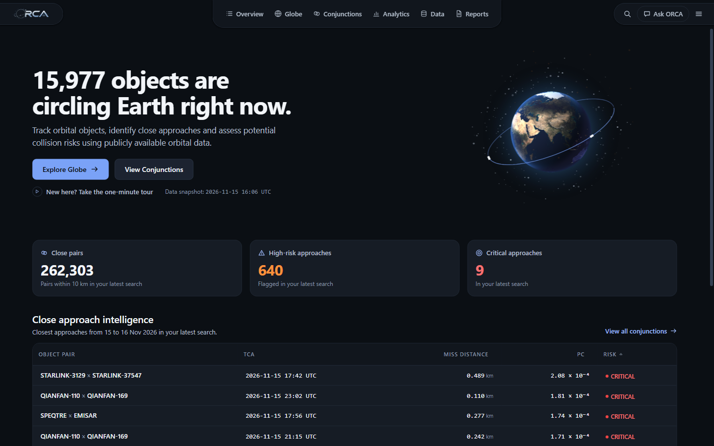
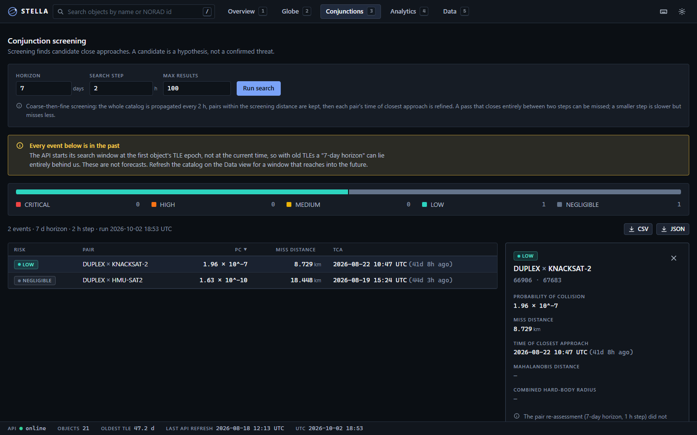
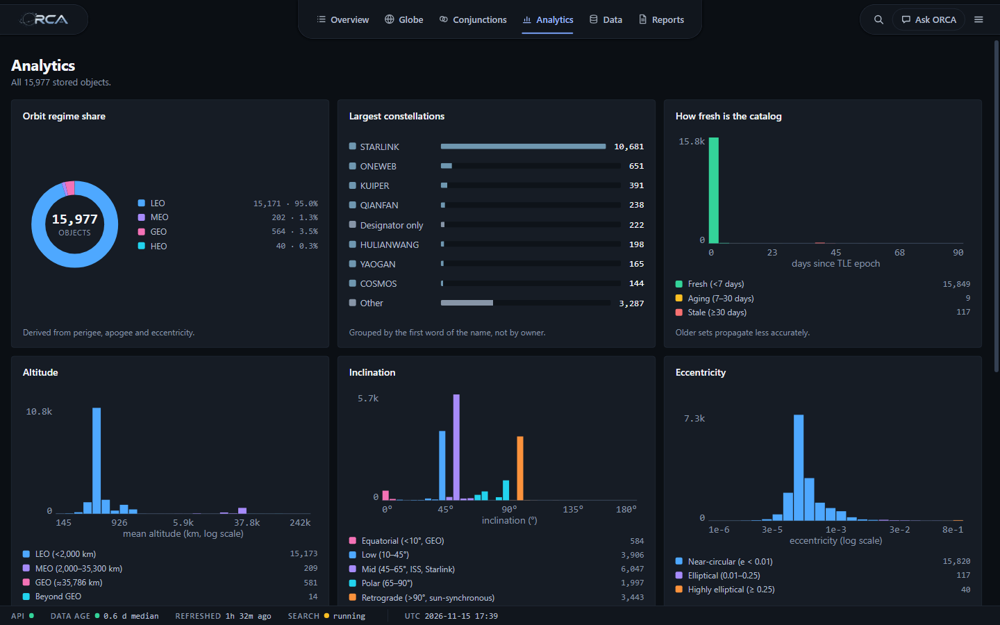
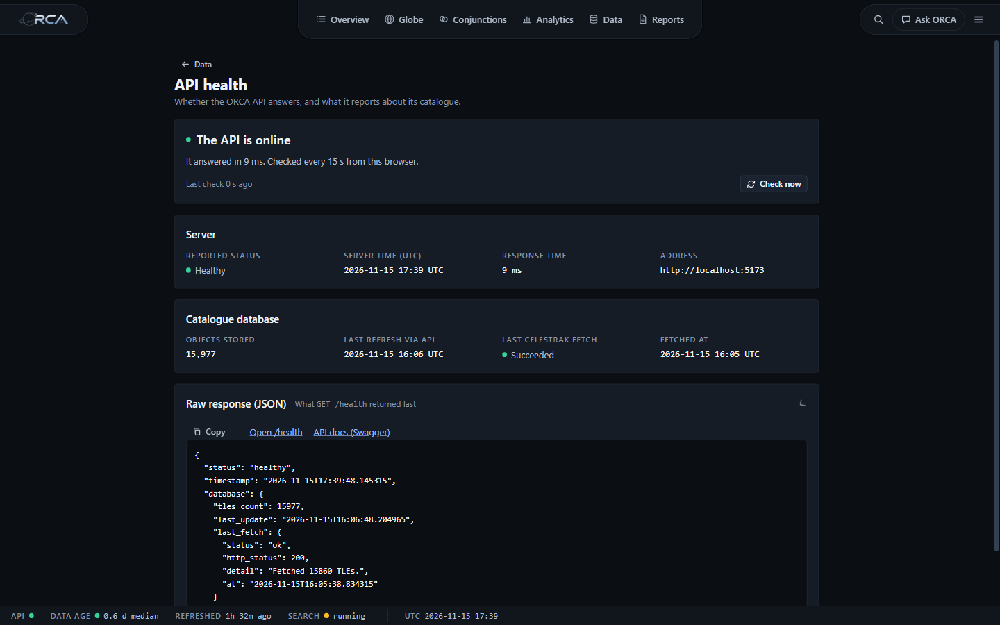

# ORCA

**Open-source space situational awareness: from raw TLEs to ranked collision risk.**

ORCA ingests public satellite tracking data, propagates orbits, screens the catalog for close approaches (conjunctions), and ranks them by collision probability. Results are served through a REST API and a React + three.js app. It runs entirely on free, open-source parts: no STK, no paid API keys.

**Not an operational system.** ORCA is an educational and research tool built on public TLEs. Its outputs must not be used for real manoeuvre decisions. See [Limitations](#limitations).

## Preview

| Home | Globe | Conjunctions |
|---|---|---|
|  |  |  |

| Overview | Analytics | API health |
|---|---|---|
|  |  |  |

Screenshots from 2026-11-15 (1440 px, dark theme, a live 1-day search over 15,977 objects).

## What it does

1. **Ingest** TLEs from [Celestrak](https://celestrak.org/) into a local SQLite file.
2. **Propagate** each object with SGP4 to a position and velocity at any time up to 7 days ahead.
3. **Screen** the catalog for conjunctions: every object every 20 s, with a KD-tree radius wide enough that no approach closer than 10 km can fall between two steps. Each time of closest approach (TCA) is then refined with exact SGP4 states.
4. **Rank** events by probability of collision (Pc, Foster's 2D method with a measured TLE uncertainty) into five risk tiers, and say next to every number what the tier depends on.
5. **Show** it: a 3D globe, sortable tables, charts, pair detail and CSV/JSON export.

The conjunction engine was rebuilt on 2026-10-15 (engine v2) after the original one was measured and found to miss most close approaches.

Screening is not risk assessment. A pair that passes screening is a hypothesis; only the analysis stage says how dangerous it is.

## Quick start

You need Python 3.9+ and Node 20.19+.

```bash
# one-time setup
python -m venv .venv
source .venv/Scripts/activate        # Git Bash on Windows; use .venv/bin/activate on macOS/Linux
pip install -r requirements.txt
cd frontend && npm install && cd ..

# 1. API on http://127.0.0.1:8000  (docs at /docs)
PYTHONIOENCODING=utf-8 uvicorn api_server:app --port 8000

# 2. React frontend on http://127.0.0.1:5173  (second terminal)
cd frontend && npm run dev

# 3. Load data (or use the Data view in the app)
curl -X POST http://127.0.0.1:8000/api/update-tles
```

**Sign in.** Set a password once with `python auth.py set-password` (user `admin`). Optionally, show a shared demo login on the sign-in page ("Evaluator access") by putting the same values in `frontend/.env.local` as `VITE_EVALUATOR_USERNAME` and `VITE_EVALUATOR_PASSWORD`. That file is git-ignored, but anything set there is public in the built bundle, so use a demo credential.

`PYTHONIOENCODING=utf-8` is **required on Windows**: the parser prints a Unicode check mark per TLE, which crashes on the default `cp1252` console and silently truncates ingestion.

Celestrak returns `403` if the large `active` group is requested repeatedly in a short time. The refresh then looks like an empty fetch. Wait a while, or seed from the small `stations` group.

## Architecture

```
Celestrak TLEs ──► parser_pipeline.py ──► orbit_mech_engine.py ──► conjunction_detection.py ─┐
                   (SQLite: ssa_data.db)   (propagation, frames)    (KD-tree, TCA, Pc)        │
                                                  │                                            ▼
                                                  └────────────► Analytics.py ───────► api_server.py (FastAPI :8000)
                                                                                              ▼
                                                                                   frontend/ (React + three.js :5173)
```

| Module | Role |
|---|---|
| `parser_pipeline.py` | TLE parsing (including BSTAR notation), Celestrak client, SQLite storage |
| `orbit_mech_engine.py` | Foundation layer: orbital elements, Kepler solver, SGP4 propagator (`SGP4Propagator`), ECI/ECEF/geographic transforms. Imports no other project module |
| `conjunction_detection.py` | Gap-free screening, exact TCA, Foster Pc with a measured uncertainty model, risk tiers, and the method description served to the UI |
| `Analytics.py` | Catalog statistics, Plotly figures, export helpers |
| `api_server.py` | REST API |
| `frontend/` | React + TypeScript + Vite + three.js app, one component per UI piece ([frontend/README.md](frontend/README.md)) |

The frontend reads the SQLite file only through the API.

## The frontend

| Key | View | What it does |
|---|---|---|
| `1` | Overview | Catalog KPIs, sortable table, object detail, regime breakdown |
| `2` | Globe | three.js Earth with every object, orbit paths, time scrub up to +7 days |
| `3` | Conjunctions | Cancellable search, a "How this list is made, and what it cannot tell you" panel, tier counts over everything found, uncertainty and TLE age per event, pair detail, CSV/JSON export |
| `4` | Analytics | Server statistics plus histograms and a scatter plot |
| `5` | Data | Catalog freshness and a Celestrak refresh with honest progress |

`/` focuses search, `T` toggles light and dark, `?` lists every shortcut, `Esc` steps back once per press.

The UI shows TLE age next to every object, names the propagator it is using (read from the API response), and distinguishes "not loaded yet", "ran and found nothing" and "request failed".

## API

Interactive docs at `/docs` (Swagger) and `/redoc`.

| Method | Path | Description |
|---|---|---|
| GET | `/health` | Status, stored object count, last API refresh time |
| GET | `/api/tles` | List TLEs (`limit` up to 5000) |
| GET | `/api/tle/{norad_id}` | One TLE |
| POST | `/api/update-tles` | Start a background Celestrak fetch (no completion event: poll `/health`) |
| GET | `/api/propagate/{norad_id}` | SGP4 state vector `hours_ahead` after the TLE epoch (0 to 168); 422 if SGP4 refuses the element set (e.g. decayed) |
| GET | `/api/positions` | Bulk positions and velocities at now + `hours_offset` (for the globe) |
| GET | `/api/orbit-path/{norad_id}` | One orbital period of ECI positions |
| GET | `/api/orbital-elements/{norad_id}` | Keplerian elements (angles in degrees) |
| GET | `/api/conjunctions` | Catalog-wide search (`time_horizon_days` 1 to 7, default 1; `limit` rows). Returns `{events, total_events, tier_counts, long_encounters, window_start, window_end, objects, report_km, step_s, runtime_s}`. `search_step_hours` is accepted and ignored |
| GET | `/api/conjunctions/method` | How conjunctions are found and scored, and the limits of the result (shown in the UI) |
| GET | `/api/conjunction-pair/{id1}/{id2}` | The pair's closest approach under 10 km in the next 7 days, or `no_risk` |
| GET | `/api/statistics` | Apogee, perigee, period and inclination summary |
| GET | `/api/export/conjunctions` | Server-side export (`format=json` or `csv`): 1-day horizon from now, the 10,000 most probable events. The frontend exports in the browser instead |
| GET | `/api/assistant/status` | Whether the optional AI answers (Groq) are on: `{enabled, model, reason}` |
| POST | `/api/assistant/ask` | `{question, context: {view, facts}}` to `{answer, model, label: "AI-generated"}`. 503 when off, 400 bad input, 429 over the per-user limit, 502 when Groq fails |

CORS defaults to the Vite dev origins. Set `ORCA_CORS_ORIGINS="https://a.example,https://b.example"` to allow others.

### Ask ORCA assistant (optional AI answers, off by default)

"Ask ORCA" answers from the loaded data and a fixed set of intents with no key and no network call. A server operator can also let free-text questions it does not recognise go to **Groq** (an OpenAI-compatible API). ORCA never needs this: it is an opt-in extra, in line with "no paid keys for core function". No extra package is needed: the call uses `requests`.

To turn it on, put the key in the git-ignored **`.env`** file next to `api_server.py` (a template is in `.env.example`), then restart the API. Never put it in `frontend/.env*`: anything there is baked into the public bundle.

```bash
# .env  (read once at API start by envfile.py; a variable already in the real environment wins)
GROQ_API_KEY=gsk_...                          # enables the feature; empty = off, /api/assistant/ask answers 503
# ORCA_ASSISTANT_MODEL=openai/gpt-oss-120b     # optional; the default. Groq retires models: see console.groq.com/docs/models
# ORCA_ASSISTANT_LIMIT=20                      # optional; questions per signed-in user per window
# ORCA_ASSISTANT_WINDOW_S=600                  # optional; window length in seconds
```

- **What is sent:** the question, the name of the current view and up to 30 short facts the page already shows (aggregate figures from public TLEs). No credential, database file or other server data is sent.
- **The key** stays on the server. It is never returned by the API and never logged; the log line per question has only the provider, model, an outcome code and the latency.
- **In the UI** every AI answer is labelled "AI · <model>", with a note that it may be wrong and the facts it was given. The system prompt tells the model to answer only from those facts and general orbital mechanics, to say when the facts do not hold the answer, and never to invent catalog numbers, positions or collision probabilities. It is not for operational decisions.

**Hosted copy:** https://orca-vitap.vercel.app (frontend on Vercel, API on an Oracle Cloud Always Free VM). Every push to `main` redeploys it. As of 2026-10-15 the hosted copy still runs the original engine: the v2 work is on the branch `fix/honest-conjunctions`, not yet merged or pushed.

## How the risk model works

The method is also served by `GET /api/conjunctions/method` and shown on the Conjunctions page.

**Propagation.** SGP4, the model TLEs are fitted for (the `sgp4` package, which wraps the reference code of Vallado et al. 2006).

**Screening.** Every object is propagated every 20 s. At each step a `scipy.spatial.cKDTree` finds every pair closer than 10 km + v_max × 10 s, where v_max is twice the fastest perigee speed in the catalog (about 167–211 km in practice). By the sampling condition r ≥ d + v·Δt/2, no approach closer than 10 km can fall between two steps.

**Closest approach.** A parabola through d² at the three samples around each grid minimum locates the TCA. Both objects are then propagated exactly at that time and corrected by one range-rate step. The miss distance and relative velocity come from SGP4.

**Probability of collision.** Foster's 2D method: the Gaussian relative-position uncertainty, projected onto the encounter plane, is integrated over the disc of the combined hard-body radius.
- TLEs carry no covariance, so each object's radial / in-track / cross-track uncertainty is a model. It is measured from successive public TLEs (2026-10-14), kept separate for Starlink, and floored at ESA's published at-epoch TLE uncertainties.
- Encounters slower than 0.1 km/s are flagged as **long encounters**, for which the 2D model can be several times too low.

| Risk tier | Pc |
|---|---|
| CRITICAL | > 1×10⁻⁴ |
| HIGH | > 1×10⁻⁵ |
| MEDIUM | > 1×10⁻⁶ |
| LOW | > 1×10⁻⁷ |
| NEGLIGIBLE | otherwise |

NASA's Conjunction Assessment handbook (NASA/SP-20205011318, 2020) recommends mitigation above 1×10⁻⁴.

Hard-body radius is looked up by name keyword: Starlink 5.65 m, OneWeb 4.0 m, Iridium 3.9 m, CubeSat 0.5 m, debris 0.1 m, anything else 3.0 m.

**Units** (a past bug source): `OrbitalElement.n` is rad/s, `OrbitalElement.i` is radians, `TLE.inclination` is degrees, positions are km and velocities km/s in the ECI frame.

## Limitations

These are real, current behaviours, not boilerplate:

- **TLEs are not accurate enough for operations.** NASA does not recommend TLE-based conjunction assessment for operational decisions. TLE error is mostly along-track: about 0.16 km after a third of a day and about 15 km after 6 days for non-Starlink LEO objects, and roughly 15 times worse for Starlink. Refresh the catalog before reading anything into a result.
- **Every Pc and tier depends on the uncertainty model.** The model is measured from one day of public TLEs (LEO only) and floored at ESA's values. A different, equally plausible model can move the tier by orders of magnitude.
- **Long encounters** (relative speed under 0.1 km/s) are flagged: their 2D Pc can be several times too low. Only their closest approach per pair is listed.
- **Searches take minutes.** About 1.5–2 min per day of horizon for ~16,000 objects on a laptop. That is the cost of not missing approaches; the original engine took ~20 s and caught about 0.1 % of them.
- **Cancel stops waiting, not computing.** Cancelling a search stops the browser waiting; the server finishes the search anyway.
- **Single operator and a single SQLite file.** One login, no per-user accounts. Suitable for local or trusted-network use.
- **CI covers the backend only.** GitHub Actions runs the Python tests (`python -m unittest discover -s tests`, 89 tests) before every backend deploy. The frontend unit tests (`cd frontend && npm test`, 89 tests) and typecheck are run by hand.

## Contact

Suggestions and feedback are welcome: **suryapratik12@gmail.com**

## License

Apache License 2.0. See [LICENSE](LICENSE).
