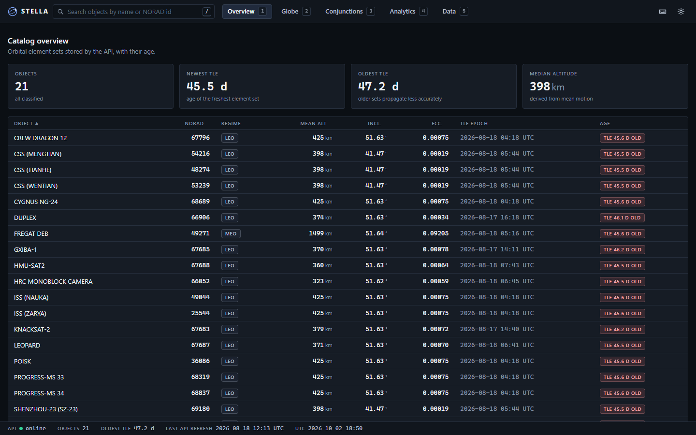
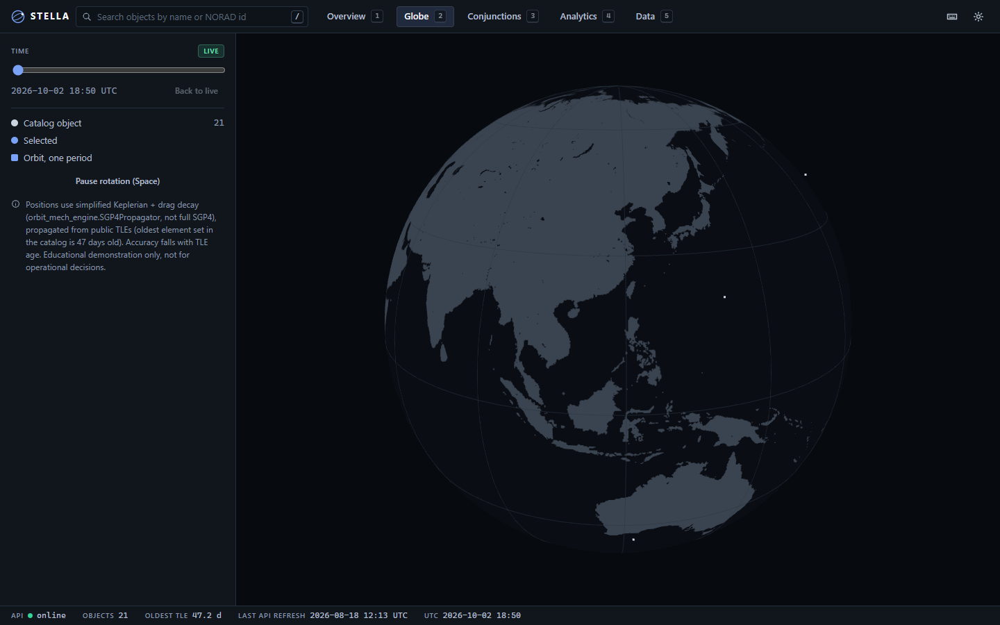
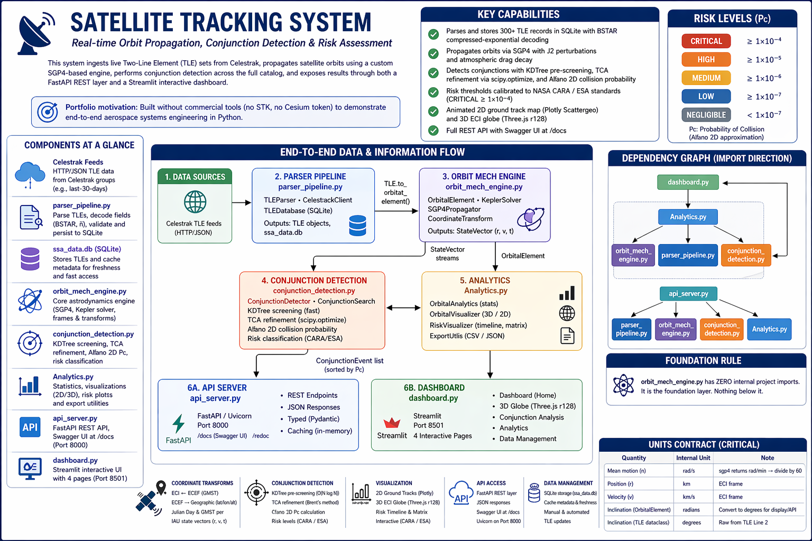

# ORCA

**Open-source space situational awareness: from raw TLEs to ranked collision risk.**

ORCA ingests public satellite tracking data, propagates orbits, screens the catalog for close approaches (conjunctions), and ranks them by collision probability. Results are served through a REST API and two front ends: a React + three.js app and the original Streamlit dashboard. It runs entirely on free, open-source parts: no STK, no paid API keys.

> **Not an operational system.** ORCA is an educational and research tool built on public TLEs. Its outputs must not be used for real manoeuvre decisions. See [Limitations](#limitations).

## Preview

| Overview | Globe | Conjunctions |
|---|---|---|
|  |  |  |

The original Streamlit dashboard is still included (`dashboard.py`):



## What it does

1. **Ingest** TLEs from [Celestrak](https://celestrak.org/) into a local SQLite file.
2. **Propagate** each object to a position and velocity at any time up to 7 days ahead.
3. **Screen** the catalog for conjunctions: a KD-tree finds candidate pairs, then each pair's time of closest approach (TCA) is refined.
4. **Rank** events by probability of collision (Pc) into five risk tiers.
5. **Show** it: a 3D globe, sortable tables, charts, pair detail and CSV/JSON export.

Screening is not risk assessment. A pair that passes screening is a hypothesis; only the analysis stage says how dangerous it is.

## Quick start

You need Python 3.9+ and Node 20.19+.

```bash
# one-time setup
python -m venv .venv
source .venv/Scripts/activate        # Git Bash on Windows; use .venv/bin/activate on macOS/Linux
pip install -r requirements.txt
cd frontend && npm install && cd ..

# 1. API on http://127.0.0.1:8000  (docs at /docs)
PYTHONIOENCODING=utf-8 uvicorn api_server:app --port 8000

# 2. React frontend on http://127.0.0.1:5173  (second terminal)
cd frontend && npm run dev

# 3. Load data (or use the Data view in the app)
curl -X POST http://127.0.0.1:8000/api/update-tles
```

`PYTHONIOENCODING=utf-8` is **required on Windows**: the parser prints a Unicode check mark per TLE, which crashes on the default `cp1252` console and silently truncates ingestion.

The legacy Streamlit dashboard runs separately: `PYTHONIOENCODING=utf-8 streamlit run dashboard.py --server.port 8501`.

Celestrak returns `403` if the large `active` group is requested repeatedly in a short time. The refresh then looks like an empty fetch. Wait a while, or seed from the small `stations` group.

## Architecture

```
Celestrak TLEs ──► parser_pipeline.py ──► orbit_mech_engine.py ──► conjunction_detection.py ─┐
                   (SQLite: ssa_data.db)   (propagation, frames)    (KD-tree, TCA, Pc)        │
                                                  │                                            ▼
                                                  └────────────► Analytics.py ───────► api_server.py (FastAPI :8000)
                                                                                              │
                                                              ┌───────────────────────────────┴──────────┐
                                                              ▼                                          ▼
                                                   frontend/ (React + three.js :5173)         dashboard.py (Streamlit :8501)
```

| Module | Role |
|---|---|
| `parser_pipeline.py` | TLE parsing (including BSTAR notation), Celestrak client, SQLite storage |
| `orbit_mech_engine.py` | Foundation layer: orbital elements, Kepler solver, propagator, ECI/ECEF/geographic transforms. Imports no other project module |
| `conjunction_detection.py` | Two-phase screening, TCA refinement, Pc and risk tiers |
| `Analytics.py` | Catalog statistics, Plotly figures, export helpers |
| `api_server.py` | REST API |
| `frontend/` | React + TypeScript + Vite + three.js app, one component per UI piece ([frontend/README.md](frontend/README.md)) |
| `dashboard.py` | Legacy Streamlit dashboard |

The front ends do not call each other. Both read the same SQLite file through the same modules or API. More detail is in [ARCHITECTURE.md](ARCHITECTURE.md).

## The frontend

| Key | View | What it does |
|---|---|---|
| `1` | Overview | Catalog KPIs, sortable table, object detail, regime breakdown |
| `2` | Globe | three.js Earth with every object, orbit paths, time scrub up to +7 days |
| `3` | Conjunctions | Cancellable screening search, risk summary, pair detail, CSV/JSON export |
| `4` | Analytics | Server statistics plus histograms and a scatter plot |
| `5` | Data | Catalog freshness and a Celestrak refresh with honest progress |

`/` focuses search, `T` toggles light and dark, `?` lists every shortcut, `Esc` steps back once per press.

The UI shows TLE age next to every object, names the propagator it is using (read from the API response), and distinguishes "not loaded yet", "ran and found nothing" and "request failed". The rules are in [rules.md](rules.md).

## API

Interactive docs at `/docs` (Swagger) and `/redoc`.

| Method | Path | Description |
|---|---|---|
| GET | `/health` | Status, stored object count, last API refresh time |
| GET | `/api/tles` | List TLEs (`limit` up to 5000) |
| GET | `/api/tle/{norad_id}` | One TLE |
| POST | `/api/update-tles` | Start a background Celestrak fetch (no completion event: poll `/health`) |
| GET | `/api/propagate/{norad_id}` | State vector `hours_ahead` after the TLE epoch (0 to 168) |
| GET | `/api/positions` | Bulk positions and velocities at now + `hours_offset` (for the globe) |
| GET | `/api/orbit-path/{norad_id}` | One orbital period of ECI positions |
| GET | `/api/orbital-elements/{norad_id}` | Keplerian elements (angles in degrees) |
| GET | `/api/conjunctions` | Catalog-wide search (`time_horizon_days` 1 to 30, `search_step_hours`, `limit`) |
| GET | `/api/conjunction-pair/{id1}/{id2}` | Assess one pair |
| GET | `/api/statistics` | Apogee, perigee, period and inclination summary |
| GET | `/api/export/conjunctions` | Server-side export (writes to `/tmp`, so it fails on Windows; the frontend exports in the browser instead) |

CORS defaults to the Vite dev origins. Set `ORCA_CORS_ORIGINS="https://a.example,https://b.example"` to allow others.

## How the risk model works

**Screening.** The catalog is propagated at a coarse step (`search_step_hours`). A `scipy.spatial.cKDTree` finds pairs within `initial_screen_km` (default 100 km) in roughly O(N log N). Only those pairs get a precise TCA, found with bounded Brent minimisation in a ±`refine_window_hours` window. A pass that closes entirely between two steps can be missed.

**Probability of collision.** A simplified Alfano 2D Gaussian method: relative position uncertainty is treated as Gaussian, the collision region is a circle of the combined hard-body radius, and a single equivalent sigma stands in for the spread. TLEs carry no covariance, so uncertainty is an assumption: `sigma = 0.5 km + 2.0 km/day × age`.

| Risk tier | Pc |
|---|---|
| CRITICAL | > 1×10⁻⁴ |
| HIGH | > 1×10⁻⁵ |
| MEDIUM | > 1×10⁻⁶ |
| LOW | > 1×10⁻⁷ |
| NEGLIGIBLE | otherwise |

Hard-body radius is looked up by name keyword: Starlink 5.65 m, OneWeb 4.0 m, Iridium 3.9 m, CubeSat 0.5 m, debris 0.1 m, anything else 3.0 m.

**Units** (a past bug source): `OrbitalElement.n` is rad/s, `OrbitalElement.i` is radians, `TLE.inclination` is degrees, positions are km and velocities km/s in the ECI frame. The full contract is in [ARCHITECTURE.md](ARCHITECTURE.md#7-units-contract).

## Limitations

These are real, current behaviours, not boilerplate:

- **Simplified propagation.** `orbit_mech_engine.SGP4Propagator` is a Kepler solver with an exponential drag-decay term, not full SGP4. The `sgp4` package is used to parse TLEs.
- **Stale data degrades everything.** Orbit prediction accuracy falls quickly with TLE age. Refresh the catalog before reading anything into a result.
- **The conjunction search window starts at the first object's TLE epoch, not at the current time** (`conjunction_detection.py`). With old TLEs, a "7-day horizon" can lie entirely in the past. The frontend warns when results are in the past.
- **Pc uses an assumed covariance**, so it is a ranking aid, not a validated collision probability.
- **A failed Celestrak fetch looks like an empty catalog.** The API swallows the failure into an empty list.
- **No authentication and a single SQLite file.** Suitable for local or trusted-network use only.
- **No CI yet**, and the Python side has no automated tests. The frontend has unit tests for its pure logic (`cd frontend && npm test`).

## Project documents

| Question | File |
|---|---|
| How do I work in this repo? (conventions, how to verify a change) | [AGENTS.md](AGENTS.md) |
| How do the pieces fit together? | [ARCHITECTURE.md](ARCHITECTURE.md) |
| Why was it built this way? What broke before? | [DECISIONS.md](DECISIONS.md) |
| What is it for, and for whom? | [PRD.md](PRD.md) |
| What is left to do? | [TASKS.md](TASKS.md) |
| How must UI be built? | [rules.md](rules.md) |

## Contact

Suggestions and feedback are welcome: **suryapratik12@gmail.com**

## License

Apache License 2.0. See [LICENSE](LICENSE).
